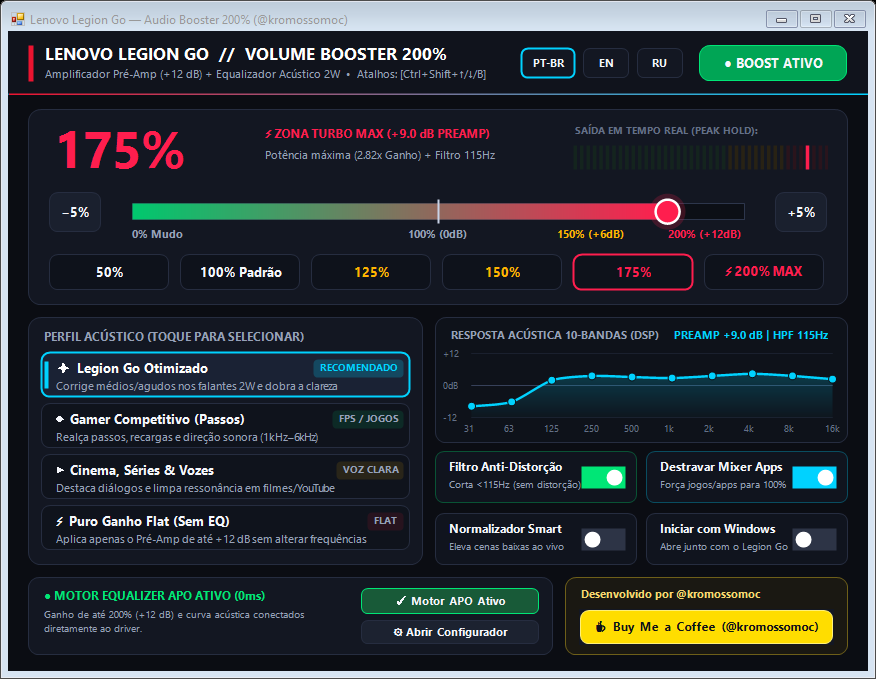

# ⚡ Lenovo Legion Go — Volume Booster 200%

  
  
  
  

  
  &nbsp;&nbsp;
  

 

---

## 🇧🇷 Português (PT-BR)

Amplificador de volume até **200% (+12 dB)** e equalizador acústico em tempo real (`0ms` de atraso) desenvolvido especificamente para corrigir o som baixo de fábrica dos alto-falantes de 2W do **Lenovo Legion Go**.

### Principais Recursos
- **Boost Real de `0%` a `200%` (`+12.0 dB` Preamp):** Ultrapassa o limite padrão de 100% do Windows sem atraso nos jogos.
- **4 Perfis Acústicos no Painel Touch:**
  - **✦ Legion Go Otimizado:** Corrige os médios e agudos dos alto-falantes de 2W, dobrando o volume percebido e a clareza.
  - **◈ Gamer Competitivo (Passos):** Destaca passos, recargas e direção sonora (`1 kHz – 6 kHz`).
  - **▶ Cinema, Séries & Vozes:** Foco total na nitidez de vozes e diálogos.
  - **⚡ Puro Ganho Flat:** Apenas pré-amplificação sem curva de equalização.
- **Filtro Anti-Distorção (`115 Hz High-Pass`):** Corta sub-graves que fazem o alto-falante rachar em `200%`.
- **Idiomas:** Português (`PT-BR`), Inglês (`EN`) e Russo (`RU`) em tempo real.
- **Atalhos Globais nos Jogos:** `Ctrl + Shift + ↑` (+10%) | `Ctrl + Shift + ↓` (-10%) | `Ctrl + Shift + B` (Liga/Desliga).

### Como Usar
1. Baixe o **[LegionGoVolumeBooster.exe](https://github.com/kromossomom-debug/volume-booster-legiongo/raw/main/LegionGoVolumeBooster.exe)** e abra o programa.
2. Para ativar o ganho acima de 100% (`+12 dB` reais no driver Realtek), clique em **`⚡ Instalar Motor APO`** dentro do aplicativo, marque **`Speakers (Realtek Audio)`** no configurador e reinicie o Legion Go uma vez.

---

## 🇺🇸 English (EN)

Real-time **200% (+12 dB)** volume booster and acoustic equalizer (`0ms` latency) built specifically to fix the quiet factory 2W top-firing speakers on the **Lenovo Legion Go**.

### Key Features
- **True `0%` to `200%` Boost (`+12.0 dB` Preamp):** Bypasses Windows' 100% volume cap with zero audio delay.
- **4 Touch-Friendly Acoustic Profiles:** *Legion Go Optimized*, *Competitive Gaming (Footsteps)*, *Cinema & Voice*, and *Pure Flat Gain*.
- **Anti-Distortion Protection (`115 Hz High-Pass`):** Prevents speaker rattle and clipping at 200% volume.
- **Multi-Language UI:** Instant switch between `PT-BR`, `EN`, and `RU`.
- **In-Game Global Hotkeys:** `Ctrl + Shift + ↑` (+10%) | `Ctrl + Shift + ↓` (-10%) | `Ctrl + Shift + B` (Toggle Boost).

### How to Use
1. Download and run **[LegionGoVolumeBooster.exe](https://github.com/kromossomom-debug/volume-booster-legiongo/raw/main/LegionGoVolumeBooster.exe)**.
2. Click **`⚡ Install APO Engine`** inside the app, select **`Speakers (Realtek Audio)`** in the Configurator window, and reboot once.

---

## 🇷🇺 Русский (RU)

Усилитель громкости до **200% (+12 дБ)** и акустический эквалайзер в реальном времени (`0 мс` задержки), созданный специально для динамиков 2Вт портативной консоли **Lenovo Legion Go**.

### Основные возможности
- **Реальное усиление от `0%` до `200%` (`+12.0 дБ` Preamp):** Обходит штатный лимит 100% в Windows без задержки звука в играх.
- **4 акустических профиля:** *Legion Go Оптимум*, *Игровой режим (Шаги)*, *Кино и Голос*, *Чистое усиление (Flat)*.
- **Защита от хрипа (`Фильтр ВЧ 115 Гц`):** Защищает динамики 2Вт от перегрузки и дребезжания на 200%.
- **Горячие клавиши в играх:** `Ctrl + Shift + ↑` (+10%) | `Ctrl + Shift + ↓` (-10%) | `Ctrl + Shift + B` (Вкл/Выкл Буст).

---

## ☕ Apoie o Desenvolvedor / Support the Developer

👉 **[https://www.buymeacoffee.com/kromossomoc](https://www.buymeacoffee.com/kromossomoc)**

---

**Copyright © 2026 [@kromossomoc](https://www.buymeacoffee.com/kromossomoc) — Todos os direitos reservados / All rights reserved.**
